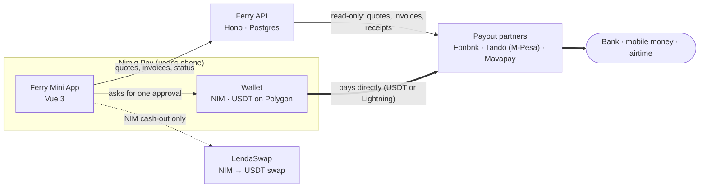

<p align="center">
  
</p>

<h1 align="center">Ferry</h1>

<p align="center">
  <strong>Cash out NIM or USDT from Nimiq Pay to banks, mobile money and airtime in 13 countries.</strong><br />
  A self-custodial Nimiq Pay Mini App. Compare offers, approve once, and watch the money land.
</p>

<p align="center">
  <a href="https://ferry-beta.vercel.app">Live app</a> ·
  <a href="https://ferry-beta.vercel.app/proof">Proof of Ferry</a> ·
  <a href="docs/guided-tour.md">Guided tour</a> ·
  <a href="docs/architecture.md">Architecture</a> ·
  <a href="docs/api.md">API</a>
</p>

---

## Contents

| Section                                                           | What you'll find                                                   |
| ----------------------------------------------------------------- | ------------------------------------------------------------------ |
| [Why Ferry](#why-ferry)                                           | The problem and who it's for                                       |
| [Try it](#try-it)                                                 | Open it in Nimiq Pay, on a computer, or locally without real money |
| [What it does](#what-it-does)                                     | Every feature, country and payout route                            |
| [How it works](#how-it-works)                                     | The one-diagram version of the architecture                        |
| [Principles](#principles)                                         | The rules the code follows, and where each one is enforced         |
| [Repository layout](#repository-layout)                           | Where everything lives                                             |
| [Run it locally](#run-it-locally)                                 | Install, configure and start in five commands                      |
| [Quality checks](#quality-checks)                                 | Tests, lint, types and CI                                          |
| [Documentation](#documentation)                                   | Architecture, API reference, development guide, guided tour        |
| [Partners](#partners)                                             | The services Ferry connects to, all through public keyless APIs    |
| [Status and limits](#status-and-limits)                           | What is live, what is not, and why                                 |
| [Security, contributing, license](#security-contributing-license) | How to report issues and reuse the code                            |

## Why Ferry

Nimiq Pay holds NIM and USDT. Most people who use it need **local money** to pay rent, school fees or family, through a bank or mobile money. Getting there usually means a centralized exchange, a sign-up, a deposit address you copy by hand, and a wait you can't see.

Ferry puts that last step inside Nimiq Pay:

- **Pick a country and payout method**, and see every available offer side by side, with what arrives.
- **Approve once** in Nimiq Pay. Your wallet pays the partner directly; Ferry never holds the money.
- **Watch it land**, with the partner's receipt (an M-Pesa code, for example) shown when it arrives.

## Try it

| Where                             | How                                                                                                                                           |
| --------------------------------- | --------------------------------------------------------------------------------------------------------------------------------------------- |
| **In Nimiq Pay** (the real thing) | Open Nimiq Pay → **Mini Apps** → **Custom URL** → `ferry-beta.vercel.app`                                                                     |
| **On a computer**                 | [ferry-beta.vercel.app](https://ferry-beta.vercel.app) shows the landing page; [/proof](https://ferry-beta.vercel.app/proof) shows live usage |
| **Locally, with no real money**   | [Run it locally](#run-it-locally) with `VITE_MOCK_WALLET=true`: the full app runs in a desktop browser with a fake wallet                     |

New here? The **[guided tour](docs/guided-tour.md)** walks through the app and the code in about ten minutes.

## What it does

| Feature                   | Where                                                 | How it works                                                                                                                                                      |
| ------------------------- | ----------------------------------------------------- | ----------------------------------------------------------------------------------------------------------------------------------------------------------------- |
| **Cash out**              | 13 countries (below)                                  | Ferry asks each payout partner for a live quote and shows a **Select offer** screen. The best offer is marked **Recommended**.                                    |
| **M-Pesa Direct**         | Kenya                                                 | Every Kenyan number has a Lightning address. Ferry fetches its invoice, Nimiq Pay pays it with NIM or USDT in one approval, and Ferry shows the M-Pesa receipt.   |
| **Mavapay Money**         | Nigeria, Kenya, South Africa                          | The user's own Mavapay Money Lightning address pays out to their linked bank account. One screen, NIM or USDT.                                                    |
| **Fonbnk**                | All 13 countries                                      | Fonbnk's hosted form runs inside Ferry. Ferry then sends the USDT to Fonbnk's deposit address with one approval, topping up the gas fee if the wallet has no POL. |
| **Cash out NIM**          | Every country                                         | NIM → Lightning → USDT in the user's own wallet through a LendaSwap atomic swap. It completes, or the NIM comes back. Then cash out as usual.                     |
| **Airtime**               | 11 countries                                          | The same flow with airtime as the payout method.                                                                                                                  |
| **Pay a till or Paybill** | Kenya                                                 | M-Pesa Buy Goods and Paybill numbers as payout methods.                                                                                                           |
| **Add money**             | Nigeria, Kenya, Ghana, South Africa, Uganda, Tanzania | Fonbnk's buy flow, embedded. Ferry watches the wallet and shows the USDT when it lands.                                                                           |
| **History and receipts**  | On the device                                         | Every cash-out is kept locally with its status, receipt and links, and can be reopened to resume checking.                                                        |
| **Proof of Ferry**        | Public page                                           | Usage numbers built only from what Ferry can prove: USDT transfers seen on Polygon and M-Pesa receipts. Anyone can click through to the evidence.                 |

**Countries:** Nigeria, Kenya, Ghana, South Africa, Uganda, Tanzania, Rwanda, Zambia, The Gambia, Senegal, Côte d'Ivoire, Cameroon and Brazil. The full country × payout-method table is in [`packages/shared/src/fonbnk.ts`](packages/shared/src/fonbnk.ts).

## How it works



The thick arrows are money; the thin ones are information. **Money never passes through Ferry.** The API fetches quotes, invoices and statuses from partners, checks every invoice before the user sees it, and records what it can verify for Proof of Ferry. Full detail, with a sequence diagram for every flow, is in **[docs/architecture.md](docs/architecture.md)**.

## Principles

| Principle                    | What it means                                                                                        | Where it's enforced                                                                                                                                                                      |
| ---------------------------- | ---------------------------------------------------------------------------------------------------- | ---------------------------------------------------------------------------------------------------------------------------------------------------------------------------------------- |
| **Self-custodial**           | The user's wallet pays the partner. Ferry never holds funds, keys or seed phrases.                   | Wallet calls only go through [`providers/nimiq.ts`](apps/web/src/providers/nimiq.ts) (`@nimiq/mini-app-sdk`) and [`providers/evm.ts`](apps/web/src/providers/evm.ts) (`window.ethereum`) |
| **One tap, one approval**    | No approval on page load; never two approvals back to back.                                          | Connecting, switching to Polygon and sending are separate taps in [`FonbnkView.vue`](apps/web/src/views/cashout/FonbnkView.vue)                                                          |
| **Never pay twice**          | An uncertain payment is never retried automatically. Ferry checks the status first, then asks.       | `sendUncertain` in `FonbnkView.vue`; the "awaiting" record written before paying in [`LightningPayoutView.vue`](apps/web/src/views/cashout/LightningPayoutView.vue)                      |
| **Check before you pay**     | Every Lightning invoice is verified: mainnet, exact amount, metadata hash, enough time left.         | `validateInvoice` in [`apps/api/src/lightning.ts`](apps/api/src/lightning.ts)                                                                                                            |
| **Exact money math**         | Token amounts are `bigint` base units; fiat amounts are decimal strings. No floats for money.        | [`packages/shared/src/money.ts`](packages/shared/src/money.ts), [`apps/api/src/payouts.ts`](apps/api/src/payouts.ts)                                                                     |
| **Honest numbers**           | Quotes come from partners. Estimates are marked ≈. Proof of Ferry counts only verifiable payouts.    | [`apps/api/src/proof.ts`](apps/api/src/proof.ts), `/v1/handoffs` in [`routes/handoffs.ts`](apps/api/src/routes/handoffs.ts)                                                              |
| **No gas token needed**      | Ferry tops up a little POL so a wallet holding only USDT can send, within per-wallet and daily caps. | `POST /v1/gas` in [`routes/handoffs.ts`](apps/api/src/routes/handoffs.ts)                                                                                                                |
| **Secrets stay server-side** | Keys live only in server environment variables; logs redact keys, signatures and phone numbers.      | [`apps/api/src/env.ts`](apps/api/src/env.ts), [`apps/api/src/logger.ts`](apps/api/src/logger.ts)                                                                                         |

## Repository layout

```
ferry/
├── apps/
│   ├── web/              The Mini App and landing page (Vite, Vue 3, Pinia, vue-i18n)
│   │   └── src/
│   │       ├── views/        One file per screen; cashout/ holds the cash-out flows
│   │       ├── providers/    The only code that talks to the wallet (Nimiq SDK, window.ethereum)
│   │       ├── stores/       Session, cash-out draft and on-device history (Pinia)
│   │       ├── lib/          API client, NIM swap, formatting, friendly errors
│   │       ├── dev/          Mock wallet for desktop development (never in production builds)
│   │       └── i18n/en.json  Every user-facing string
│   └── api/              Backend (Node 22, Hono, Drizzle ORM on Postgres, viem)
│       ├── src/
│       │   ├── routes/       HTTP endpoints: offers, Lightning invoices, hand-offs, gas, stats
│       │   ├── lightning.ts  LNURL-pay client and BOLT11 invoice checks
│       │   ├── mpesa.ts      M-Pesa delivery status and receipts
│       │   ├── payouts.ts    Exact conversions and offer ranking
│       │   ├── proof.ts      Proof of Ferry statistics
│       │   └── db/           Schema and migrations
│       └── test/         Vitest suites
├── packages/shared/      zod schemas, bigint money helpers, countries and partners, shared by both apps
└── docs/                 Architecture, API reference, development guide, guided tour
```

## Run it locally

You need **Node 22+**, **pnpm 11** and **Docker** (for a local Postgres).

```sh
pnpm install
cp apps/api/.env.example apps/api/.env
pnpm db:up                       # local Postgres in Docker
pnpm --filter api db:migrate     # create the tables
pnpm dev                         # web on http://localhost:5173, API on http://localhost:3000
```

To click through every screen in a desktop browser, create `apps/web/.env.local` with `VITE_MOCK_WALLET=true`. The mock wallet shows a fake approval sheet, approves nothing real and broadcasts nothing. To try it on a phone in Nimiq Pay, see [docs/development.md](docs/development.md#test-on-a-phone).

## Quality checks

| Command          | What it runs                                      |
| ---------------- | ------------------------------------------------- |
| `pnpm test`      | 134 Vitest tests across `shared`, `api` and `web` |
| `pnpm lint`      | ESLint and Prettier                               |
| `pnpm typecheck` | TypeScript (and `vue-tsc`) in every package       |
| `pnpm build`     | Production builds of all three packages           |

[GitHub Actions](.github/workflows/ci.yml) runs all four on every push and pull request.

## Documentation

| Document                                 | Read it when you want to…                                                                 |
| ---------------------------------------- | ----------------------------------------------------------------------------------------- |
| [Guided tour](docs/guided-tour.md)       | See the app and the most important code in ten minutes                                    |
| [Architecture](docs/architecture.md)     | Understand the system, every money flow, the data model, failure handling and trust model |
| [API reference](docs/api.md)             | Call or change an endpoint                                                                |
| [Development guide](docs/development.md) | Set up, configure, test on a phone, add a country, deploy                                 |
| [Security policy](SECURITY.md)           | Report a vulnerability                                                                    |
| [Contributing](CONTRIBUTING.md)          | Send a change                                                                             |

## Partners

Ferry connects only through public, keyless interfaces. Each partner provides its service under its own terms, and Ferry is an independent project, not affiliated with any of them or with Nimiq.

| Partner                                | Used for                                                       |
| -------------------------------------- | -------------------------------------------------------------- |
| [Fonbnk](https://fonbnk.com)           | Hosted cash-out and add-money forms, live quotes, 13 countries |
| [Tando](https://tando.me)              | M-Pesa Lightning addresses and delivery receipts (Kenya)       |
| [Mavapay](https://mavapay.co)          | Mavapay Money Lightning addresses and public BTC prices        |
| [LendaSwap](https://lendasat.com)      | Lightning → Polygon USDT atomic swaps for NIM cash-outs        |
| [CoinGecko](https://www.coingecko.com) | BTC/USD price for Lightning estimates                          |

## Status and limits

- **Live on Polygon mainnet** with real money. Production runs the Fonbnk, M-Pesa Direct, Mavapay Money and NIM routes.
- **Lightning amounts are estimates** (marked ≈) until Nimiq Pay shows its swap fee at approval.
- **Paycrest route (dormant).** A second, fully gasless cash-out path through Paycrest's Gateway is built and tested against a simulated order engine, but going live needs a business-verified Paycrest key, so production uses Fonbnk. See [Architecture → Dormant paths](docs/architecture.md#11-dormant-paths).
- **Limits** follow each partner's own minimums and maximums, shown before approval.

## Security, contributing, license

- **Security:** please report vulnerabilities privately; see [SECURITY.md](SECURITY.md).
- **Contributing:** see [CONTRIBUTING.md](CONTRIBUTING.md).
- **License:** [MIT](LICENSE).
