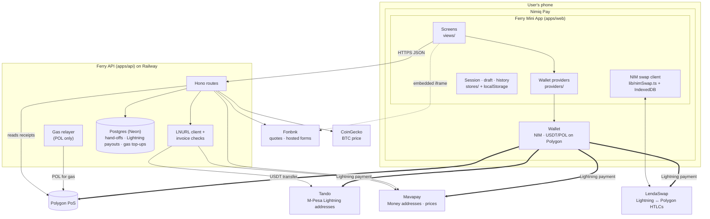
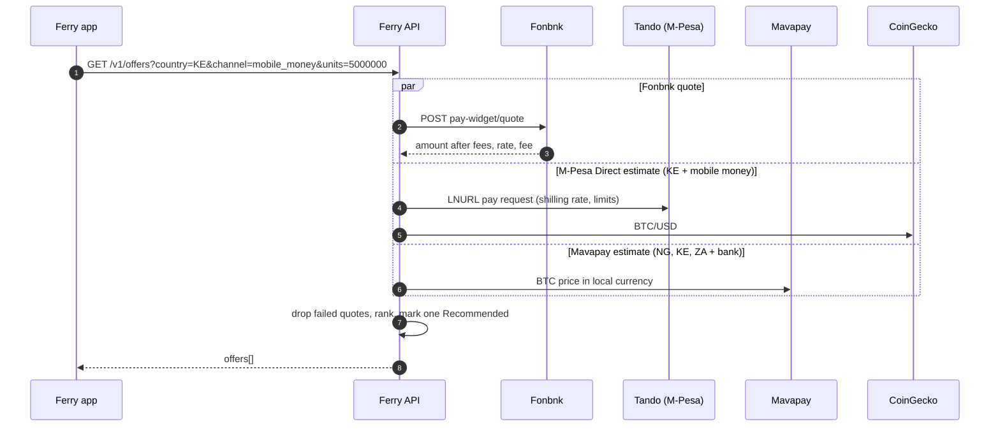
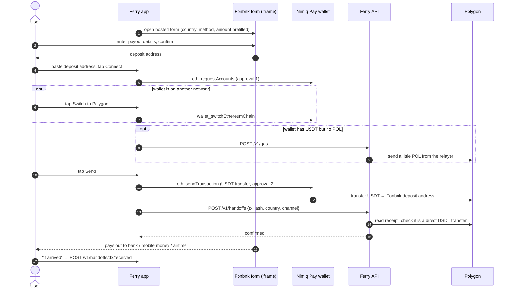
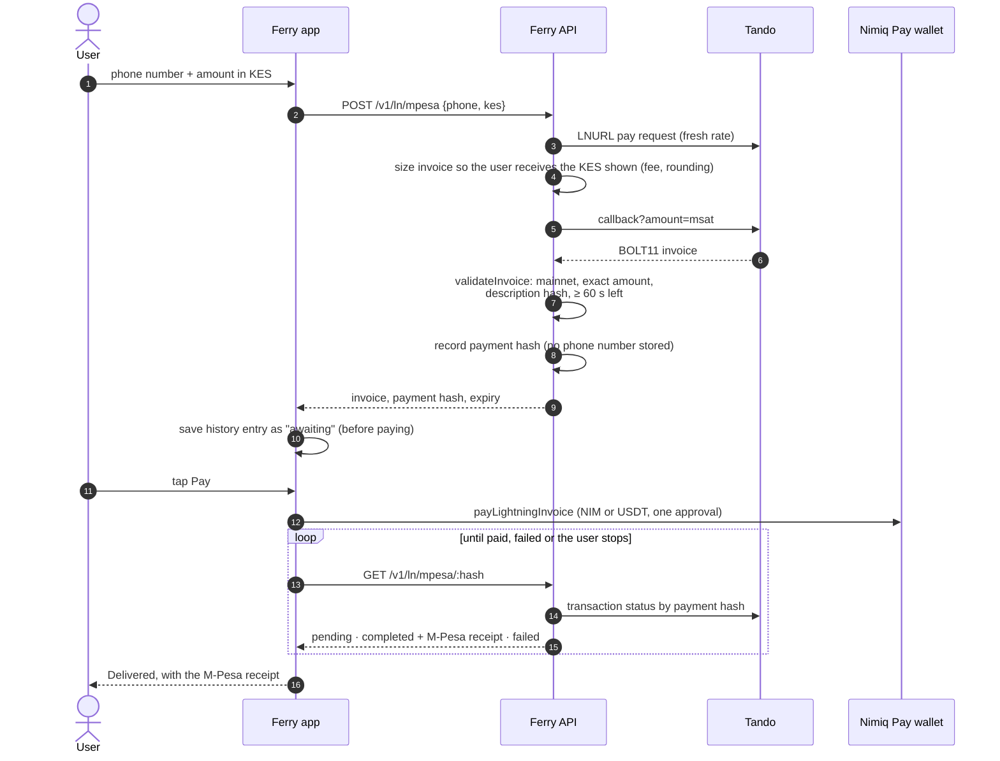
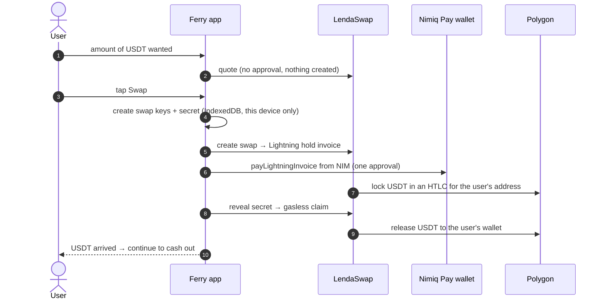
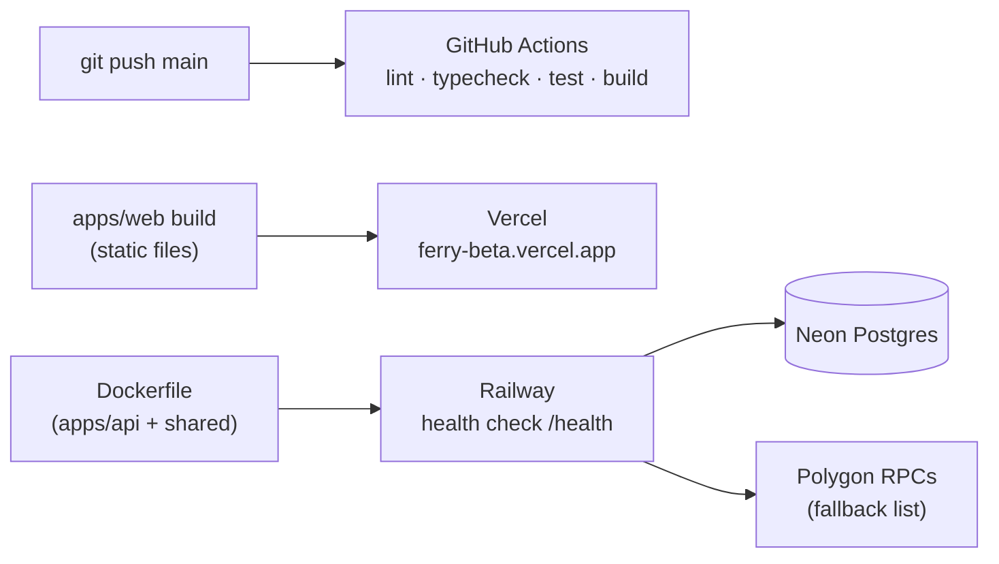

# Architecture

This document explains how Ferry is built: the parts, how money moves through each flow, what is stored, how failures are handled, and what Ferry can and cannot do with a user's funds.

## Contents

1. [Goals and constraints](#1-goals-and-constraints)
2. [System overview](#2-system-overview)
3. [Components](#3-components)
4. [Money flows](#4-money-flows)
   - [4.1 Select offer](#41-select-offer)
   - [4.2 Fonbnk cash-out](#42-fonbnk-cash-out)
   - [4.3 M-Pesa Direct](#43-m-pesa-direct)
   - [4.4 Mavapay Money](#44-mavapay-money)
   - [4.5 Cash out NIM](#45-cash-out-nim)
   - [4.6 Add money](#46-add-money)
   - [4.7 Gas top-up](#47-gas-top-up)
5. [Proof of Ferry](#5-proof-of-ferry)
6. [Data model](#6-data-model)
7. [Failure handling](#7-failure-handling)
8. [Security and trust model](#8-security-and-trust-model)
9. [Money math](#9-money-math)
10. [Deployment](#10-deployment)
11. [Dormant paths](#11-dormant-paths)
12. [Design decisions](#12-design-decisions)

## 1. Goals and constraints

| Goal                         | Constraint it puts on the design                                                                                                   |
| ---------------------------- | ---------------------------------------------------------------------------------------------------------------------------------- |
| **Self-custody**             | The user's wallet pays the payout partner directly. Ferry's server never receives user funds and never holds a user key.           |
| **One approval per payment** | Every approval follows a deliberate tap. Nothing asks for approval on page load, and approvals are never chained.                  |
| **No double payments**       | A payment with an unclear outcome is never retried automatically. Ferry checks the status, then asks the user.                     |
| **Works with no API keys**   | Every partner integration uses a public interface, so Ferry can run without business accounts or sign-ups.                         |
| **Verifiable claims**        | Public numbers (Proof of Ferry) come only from evidence a third party can check: Polygon transactions and M-Pesa receipts.         |
| **Runs inside Nimiq Pay**    | Wallet access goes only through Nimiq Pay's providers: `@nimiq/mini-app-sdk` for NIM and Lightning, `window.ethereum` for Polygon. |

## 2. System overview

Three facts hold in every flow:

1. **Money moves only from the user's wallet.** Thick arrows: a USDT transfer on Polygon or a Lightning payment that Nimiq Pay makes from NIM or USDT. The only value Ferry's server ever sends is a little POL for gas (§4.7).
2. **The server is an information broker.** It fetches quotes, invoices and statuses from known partners, validates them, and records what it can verify.
3. **The device keeps the user's records.** History lives in the browser's `localStorage`; swap secrets for NIM cash-outs live in IndexedDB and never leave the device.

## 3. Components

### 3.1 Web app: `apps/web`

Vite + Vue 3 + TypeScript, with Pinia for state, vue-i18n for every string (`src/i18n/en.json`) and UnoCSS for layout. Ferry's look comes from its own design tokens in `src/styles/tokens.css`.

| Area             | Files                                                                        | Responsibility                                                                                                                                                                                                                                    |
| ---------------- | ---------------------------------------------------------------------------- | ------------------------------------------------------------------------------------------------------------------------------------------------------------------------------------------------------------------------------------------------- |
| Routing          | `router.ts`, `views/RootView.vue`                                            | Inside Nimiq Pay, `/` is the home screen; in any other browser it is the landing page. Wallet screens (`meta.app`) redirect to the landing page outside Nimiq Pay.                                                                                |
| Host detection   | `providers/host.ts`                                                          | Reads Nimiq Pay's language, local currency and network, and whether the page is running inside Nimiq Pay.                                                                                                                                         |
| Wallet access    | `providers/nimiq.ts`, `providers/evm.ts`                                     | The **only** code that talks to the wallet. Nimiq SDK: NIM balance, `payLightningInvoice`. EVM: `eth_requestAccounts`, `wallet_switchEthereumChain`, `eth_sendTransaction`, `eth_signTypedData_v4`. Errors are classified into user-facing kinds. |
| Session          | `stores/session.ts`                                                          | Provider status, connected address, balances, and server `meta` (loaded with retry and refreshed when the app returns to the foreground).                                                                                                         |
| Cash-out screens | `views/cashout/CountryView.vue`, `FonbnkView.vue`, `LightningPayoutView.vue` | Country and method choice, Select offer, and the per-route flows below.                                                                                                                                                                           |
| NIM swap         | `views/NimView.vue`, `lib/nimSwap.ts`                                        | Quote, create, pay and claim a LendaSwap swap. The SDK loads on first use only.                                                                                                                                                                   |
| History          | `stores/history.ts`, `views/HistoryView.vue`                                 | The 50 most recent cash-outs, stored on the device under `ferry.orders.v1`. A status never moves backwards (a settled payout can't be downgraded by a late, stale read).                                                                          |
| API client       | `lib/api.ts`, `lib/ferryApi.ts`, `lib/errors.ts`                             | Typed calls with timeouts; API error codes become plain-language messages.                                                                                                                                                                        |
| Development      | `dev/mockWallet.ts`, `dev/MockWalletSheet.vue`                               | A fake Nimiq Pay for desktop browsers. Enabled only when `import.meta.env.DEV` and `VITE_MOCK_WALLET=true`, so it can't ship in a production build.                                                                                               |

### 3.2 API: `apps/api`

Node 22, [Hono](https://hono.dev), [Drizzle ORM](https://orm.drizzle.team) on Postgres, [viem](https://viem.sh) for Polygon, pino for logs. `src/app.ts` wires dependencies (environment, logger, Polygon client, relayer, database, `fetch`) into route modules, which keeps every route testable with fakes.

| Module                | Responsibility                                                                                                                                           |
| --------------------- | -------------------------------------------------------------------------------------------------------------------------------------------------------- |
| `routes/payouts.ts`   | `GET /v1/offers` (parallel partner quotes), Lightning invoices and status for M-Pesa Direct and Mavapay Money. Small time-boxed caches protect partners. |
| `routes/handoffs.ts`  | Gas top-ups and Fonbnk hand-off records, verified against the Polygon receipt.                                                                           |
| `routes/v1.ts`        | `meta` (feature flags for the web app), `stats` (Proof of Ferry), and the dormant Paycrest endpoints (§11).                                              |
| `routes/balances.ts`  | USDT and POL balances for an address.                                                                                                                    |
| `routes/health.ts`    | `/health` (liveness) and `/ready` (database, RPC and partner reachability).                                                                              |
| `lightning.ts`        | LNURL-pay client (LUD-06, LUD-16 Lightning addresses, LUD-21 verify) and BOLT11 invoice validation.                                                      |
| `mpesa.ts`            | Tando delivery status, receipt recording, and reconciliation of payouts whose sender closed the app early.                                               |
| `payouts.ts`          | Exact `bigint` conversions (USDT ↔ sats ↔ fiat), Tando's fee, swap allowance, and offer ranking.                                                         |
| `proof.ts`            | Pure function that turns database rows into Proof of Ferry statistics.                                                                                   |
| `polygon.ts`          | Polygon client with RPC fallback, fee estimation with floors and caps, relayer wallet.                                                                   |
| `env.ts`, `logger.ts` | Validated configuration (fails fast, never prints values) and redacting logger.                                                                          |

### 3.3 Shared package: `packages/shared`

Code both sides import, so the web app and the API can't disagree:

- **zod schemas** for every request and response (`schemas.ts`, `payouts.ts`).
- **Money helpers**: `parseUnits`/`formatUnits` on `bigint` base units (`money.ts`).
- **Countries and partners**: the 13 countries, their currencies, payout methods, minimums and Fonbnk URL builders (`fonbnk.ts`).
- **Normalizers** for phone numbers and addresses (`normalize.ts`, `accounts.ts`).

## 4. Money flows

### 4.1 Select offer

The user picks a country, a payout method and an amount. Ferry asks every partner that serves that combination for a quote at the same time.

- **One partner down never hides the others.** Each quote is wrapped so a failure becomes "no offer from this partner" and is logged.
- **Lightning offers are estimates** (`estimate: true`, shown as ≈). They include a 1% allowance for Nimiq Pay's swap fee and, for M-Pesa, Tando's fee of about 1%.
- **Ranking** (`recommend` in `payouts.ts`) picks the offer that delivers the most. M-Pesa Direct gets a 3% edge because it is one screen with a receipt. Mavapay gets no edge, because it needs the user's own Mavapay account.

### 4.2 Fonbnk cash-out

Available in all 13 countries for banks, mobile money, airtime and Kenyan tills and Paybills.

- Every approval is its own tap. If the wallet is on the wrong network, switching is a separate tap and approval, never chained onto the send.
- If sending fails in a way that might still have broadcast, the Send button stays locked (`sendUncertain`) until the user has checked Nimiq Pay's activity. Ferry never re-sends on its own.
- `POST /v1/handoffs` accepts only a successful transaction that calls the USDT contract directly, moves the sender's own tokens in exactly one transfer, and is under 3 days old. Contract-made transfers don't count.

### 4.3 M-Pesa Direct

Kenya only. Every Kenyan phone number has a Lightning address at Tando (`2547…@bitcoin.co.ke`) that pays M-Pesa when it receives a Lightning payment.

- The history entry is written **before** the wallet pays, so a crash or a closed app still leaves a record the user can reopen to resume checking.
- An ambiguous wallet error moves to the progress screen and checks Tando, instead of offering to pay again.
- Tando reports unpaid invoices as "pending", so Ferry also reads Tando's explicit `isPaid` flag before saying the money left the wallet.

### 4.4 Mavapay Money

Nigeria, Kenya and South Africa, for users who have a Mavapay Money account linked to their bank. The flow is the same as §4.3, with three differences:

- The user enters their own `name@mavapay.money` address. The request schema accepts only that domain, so the server can't be pointed at an arbitrary host.
- The invoice is sized from Mavapay's own public BTC price for the local currency.
- Delivery is checked through the invoice's LUD-21 verify URL. When Mavapay gives none, the status is "unknown" and the user is asked to confirm when the bank credit arrives.

### 4.5 Cash out NIM

NIM can't be paid to a bank directly, so Ferry turns it into USDT in the user's own wallet first, through a [LendaSwap](https://lendasat.com) atomic swap.

- **Atomic:** the Lightning payment is a hold invoice. It settles only when the user's device reveals the secret that also releases the USDT. If the claim never happens, the Lightning payment fails back and the NIM returns.
- **Ferry's server is not involved.** Keys and secrets live only in the browser's IndexedDB. The LendaSwap SDK is loaded on first use, so the rest of the app stays small.

### 4.6 Add money

Six countries (Nigeria, Kenya, Ghana, South Africa, Uganda, Tanzania). Fonbnk's buy form runs in an iframe; the user pays Fonbnk by bank or mobile money, and Fonbnk sends USDT to the user's Polygon address. Ferry doesn't receive a callback; it watches the wallet's USDT balance and shows the new amount when it rises. When Fonbnk's form finishes, it redirects to `/fonbnk/return` inside the iframe, which posts a same-origin message so the parent screen can move on.

### 4.7 Gas top-up

A wallet holding USDT but no POL can't pay Polygon's gas fee. `POST /v1/gas` sends just enough POL from Ferry's relayer:

- The amount is the gas limit Nimiq Pay sets for one USDT transfer × the current max fee, plus 25%, capped by `GAS_TOPUP_CAP_POL`.
- Only wallets holding at least the minimum cash-out in USDT qualify.
- Limits: `GAS_TOPUP_PER_ADDRESS_DAY` per wallet and `GAS_TOPUP_DAILY_MAX` overall, counted in the database.
- One relayer transaction at a time keeps nonces in order.
- The top-up is recorded **before** broadcast, so limits hold even when the broadcast outcome is unknown, and an unknown outcome is reported as such, never re-sent.

The relayer holds only POL for gas. It never holds or moves user funds.

## 5. Proof of Ferry

[`/proof`](https://ferry-beta.vercel.app/proof) shows public usage numbers. It counts only what a third party can check:

| Counted                 | Evidence                                                                                    | Guard against inflation                                                                                 |
| ----------------------- | ------------------------------------------------------------------------------------------- | ------------------------------------------------------------------------------------------------------- |
| Fonbnk cash-outs        | The Polygon transaction (link to Polygonscan)                                               | Must be a direct USDT transfer from the sender's wallet, successful, and under 3 days old when recorded |
| M-Pesa Direct cash-outs | The M-Pesa receipt from Tando (link to Tando's receipt page)                                | Ferry issued the invoice itself; it counts only once Tando reports it completed                         |
| Median delivery time    | Send to delivery: Tando's confirmation for M-Pesa, the sender's "It arrived" tap for Fonbnk | M-Pesa payouts found later by reconciliation count but aren't timed; anything over 2 days is left out   |
| "Arrived" confirmations | The sender tapping "It arrived" within 7 days                                               | First answer wins                                                                                       |

`computeStats` in `apps/api/src/proof.ts` is a pure function with its own tests. `/v1/stats` is cached for 30 seconds and, before computing, reconciles a few M-Pesa payouts whose senders closed the app before delivery. Wallets listed in `PROOF_EXCLUDE_ADDRESSES` are left out.

## 6. Data model

**Server (Postgres):** only what Proof of Ferry and the gas limits need. No names, phone numbers or account numbers are stored.

| Table        | One row per                       | Key columns                                                                                                                                     |
| ------------ | --------------------------------- | ----------------------------------------------------------------------------------------------------------------------------------------------- |
| `handoffs`   | Verified Fonbnk cash-out transfer | `tx_hash` (unique), `from_address`, `to_address`, `amount_units`, `country`, `channel`, `block_number`, `received_at`                           |
| `ln_payouts` | Lightning invoice Ferry issued    | `payment_hash` (unique), `route`, `country`, `channel`, `fiat_amount`, `sats`, `amount_units`, `delivered_at`, `receipt`, `timed`, `verify_url` |
| `gas_topups` | POL top-up sent by the relayer    | `address`, `amount_wei`, `tx_hash`, `created_at`                                                                                                |

The initial migration also creates tables for the dormant Paycrest path and for features that were planned but not built (`orders`, `order_events`, `webhook_events`, `relayer_txs`, `rewards`, `referrals`). Nothing in production writes to them. Migrations live in `apps/api/drizzle/` and run automatically when the API starts.

**Device:**

| Store        | Key                  | Contents                                                                                    |
| ------------ | -------------------- | ------------------------------------------------------------------------------------------- |
| localStorage | `ferry.orders.v1`    | Cash-out history: route, amounts, status, receipt, transaction or payment hash, payee label |
| IndexedDB    | LendaSwap SDK stores | Swap keys and secrets for NIM cash-outs                                                     |

## 7. Failure handling

| Situation                                               | What Ferry does                                                                                                          |
| ------------------------------------------------------- | ------------------------------------------------------------------------------------------------------------------------ |
| Wallet error after a send might have broadcast          | Locks Send until the user checks Nimiq Pay's activity. Never re-sends automatically.                                     |
| Lightning payment outcome unclear                       | Goes to the progress screen and checks the partner's status instead of paying again.                                     |
| App closed mid-payment                                  | The history entry was saved before paying; reopening it resumes status checks. The server reconciles M-Pesa payouts too. |
| Partner slow or down                                    | 8-second timeouts; that partner's offer is dropped and the others still show. Errors map to plain-language messages.     |
| Status checks running long                              | Polling stops after a while and offers "Check again", so a phone isn't kept awake indefinitely.                          |
| Relayer broadcast outcome unknown                       | Reported as unknown with the transaction hash; never re-sent. The limit counter already includes it.                     |
| Invoice from a partner doesn't match what was asked for | Rejected before the user sees it (wrong network, amount, description hash, or about to expire).                          |
| Stale status after a final one                          | History never downgrades a settled or received entry.                                                                    |
| API unreachable at startup                              | The web app retries `meta` with backoff, and again when the app returns to the foreground.                               |

## 8. Security and trust model

**What Ferry can't do.** It can't move a user's funds: it never receives them and never sees a key or seed phrase. Every payment needs the user's approval in Nimiq Pay.

**What users trust Ferry for.** Showing correct information: the right deposit address, an invoice for the right amount and recipient, honest quotes. Ferry reduces that trust with checks the user can't easily do by hand:

- Lightning invoices are decoded and checked against the request (amount, network, LNURL description hash, expiry) before they are shown.
- The M-Pesa Lightning address is derived from the normalized phone number. The Mavapay address must be on `mavapay.money`.
- The Fonbnk deposit address is shown in groups so the user can compare it with Fonbnk's form, and the transfer amount comes from the user's own entry.

**Server hardening:**

- Configuration is validated at startup with zod and refuses to run in an unsafe state (for example, production without a database). Error messages name the variable, never its value.
- Secrets (the relayer key, the database URL) exist only as server environment variables. Nothing secret is in the web bundle; `VITE_*` variables are public by design.
- Every request body, query and path parameter is parsed with a zod schema.
- Every outbound request starts at a fixed partner domain (then follows the callback or verify URL that partner returns), so user input can't make the server call an arbitrary host.
- CORS allows only configured origins (plus private-network origins in development).
- Logs redact keys, signatures, phone numbers and account details, and every error response carries a support reference instead of internals.

## 9. Money math

- Token amounts are `bigint` in base units everywhere: USDT has 6 decimals, NIM 5 (1 NIM = 100,000 Luna), POL 18.
- Fiat amounts are decimal strings or whole minor units; conversions use integer arithmetic with explicit rounding (`apps/api/src/payouts.ts`).
- Rounding always favours the user receiving at least what was shown. For example, Tando's millisatoshi amount is rounded up to a whole satoshi, so the invoice never pays out less.
- The one place a float appears is a field that Fonbnk's quote API requires as a JSON number. It is a quote request only; no money moves on that value.

## 10. Deployment

| Part     | Host    | Notes                                                                                                               |
| -------- | ------- | ------------------------------------------------------------------------------------------------------------------- |
| Web app  | Vercel  | Static build. `VITE_API_URL` points at the API; `VITE_MOCK_WALLET` is ignored in production builds.                 |
| API      | Railway | `Dockerfile` installs only the API's production dependencies, applies migrations, then starts. Restarts on failure. |
| Database | Neon    | Managed Postgres. Local development uses `docker compose` (`pnpm db:up`).                                           |

## 11. Dormant paths

**Paycrest gasless cash-out.** Before Fonbnk, Ferry was designed around [Paycrest](https://paycrest.io): the user signs an EIP-712 meta-transaction with `eth_signTypedData_v4`, Ferry's relayer submits it through USDT0's `executeMetaTransaction`, and the user pays no gas at all. The screens (`views/cashout/InstitutionView.vue`, `AccountView.vue`, `ConfirmNameView.vue`, `AmountView.vue`, `ReviewView.vue`, `views/OrderView.vue`), the signature verification (`apps/api/src/metatx.ts`) and a simulated order engine (`apps/api/src/orders/mock-engine.ts`) are built and tested. Going live needs a business-verified Paycrest API key, so production runs `PAYOUT_ROUTE=fonbnk` and these screens aren't reachable. Switching back is a configuration change plus a live order engine.

## 12. Design decisions

| Decision                                         | Why                                                                           | Trade-off                                                                                    |
| ------------------------------------------------ | ----------------------------------------------------------------------------- | -------------------------------------------------------------------------------------------- |
| Pay partners directly from the user's wallet     | Self-custody; Ferry never becomes a money transmitter holding user funds      | Ferry can't batch, net or refund payments itself                                             |
| Public, keyless partner interfaces               | Works without business accounts; anyone can run their own Ferry               | Fewer guarantees than a contracted API; quotes for Lightning routes are estimates            |
| Lightning for M-Pesa and Mavapay                 | One approval, NIM or USDT, receipt within about a minute                      | Depends on Nimiq Pay's swap; its fee is shown only at approval, so Ferry adds a 1% allowance |
| Keep history on the device                       | Nothing personal needs to be on the server                                    | History doesn't follow the user to another phone                                             |
| Record before paying or broadcasting             | A crash can never lose track of money in flight, and limits can't be bypassed | Some records are for payments that never happened; they stay "awaiting" or "unknown"         |
| A small Node API instead of serverless functions | Long-lived caches, a single in-flight relayer lock, and status reconciliation | One always-on service to run                                                                 |
| Shared zod schemas                               | The web app and API can't drift apart on a field or a type                    | Both sides build the shared package                                                          |
